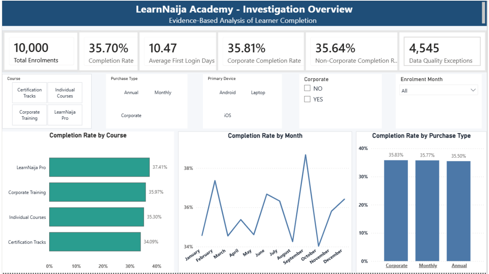
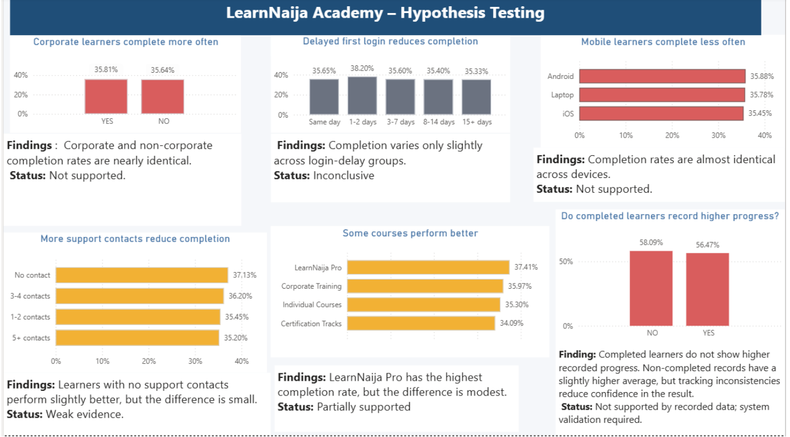
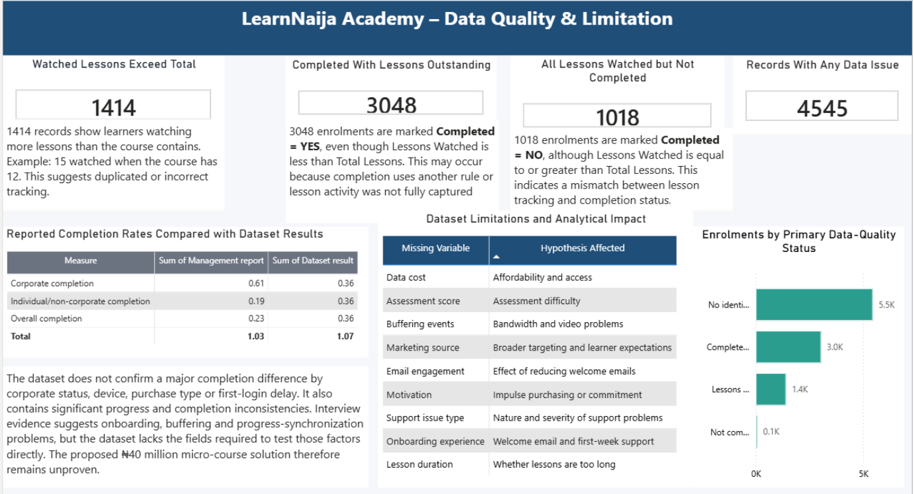

# Learning Completion & Engagement Analysis

## Project Overview

This Business Analysis and Power BI project evaluates learning completion rates, user engagement, and management assumptions using available learning platform data.

The objective was to identify factors potentially influencing course completion, assess management hypotheses, highlight data quality concerns, and provide evidence-based recommendations.

## Dashboard Pages

**1. Overview Dashboard**

Presents key performance indicators, overall completion rates, and comparisons across learner groups.

**2. Hypothesis Testing Dashboard**

Examines management assumptions about course completion, including corporate versus individual learners, device usage, and first-login delays.

**3. Data Quality & Limitations Dashboard**

Identifies inconsistencies in lesson completion records, data quality issues, and information gaps that affect the reliability of the analysis.

## Key Findings

- Overall completion rate: approximately 35.70%.
- Corporate learners' completion rate: 35.81%.
- Individual learners' completion rate: 35.64%.
- Corporate and individual completion rates were nearly identical, providing little evidence of a meaningful difference.
- Several data quality inconsistencies were identified, requiring further investigation.

## Tools Used

Power BI | Power Query | DAX | Data Cleaning | KPI Development | Business Analysis

## Project Deliverables

- Overview Dashboard
- Hypothesis Testing Dashboard
- Data Quality & Limitations Dashboard
- Business Analysis Report

## Business Value

The analysis demonstrates how evidence-based reporting can help organizations evaluate assumptions, improve data quality, identify performance gaps, and make informed business decisions.

## Power BI Dashboard Visualizations

### Dashboard 1: Investigation Overview

### Dashboard 2: Hypothesis Testing

### Dashboard 3: Data Quality & Limitations

## Project Report
[View Learning Completion & Engagement Analysis Report](Learning-Completion-and-Engagement-Analysis-Report.pdf)
